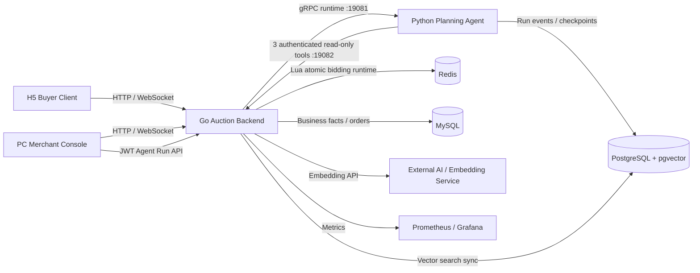

# ByteDanceliveauctioni

LiveAuction is a full-stack live commerce auction demo built for the Douyin E-commerce AI full-stack challenge. It contains a Go backend, a Python planning agent, a React merchant console, and a mobile H5 buyer client that together cover lot creation, live bidding, order settlement, real-time synchronization, and read-only AI-assisted planning/search.

## Project Overview

The system models a live auction workflow:

1. Merchants create lots, configure bidding rules, and start live auction sessions from the PC console.
2. Buyers enter the H5 live room, view current lots, place bids, and receive real-time state updates.
3. The backend validates bids, resolves winners, creates orders, and projects auction facts for query and analytics.
4. Redis handles hot real-time auction runtime state, while MySQL stores the final auditable business facts.
5. WebSocket pushes price, ranking, countdown, and settlement events to buyers and merchant screens.

## Repository Structure

```text
ByteDanceliveauctioni/
├── live-auction-bid-backend/   # Go auction backend, Redis runtime, MySQL facts, WebSocket events
├── live-auction-agent-service/ # Python 3.12 read-only planning runtime
├── live-auction-bid-frontend/  # PC merchant/admin console built with React + TypeScript + Vite
├── live-auction-user-h5/       # Mobile H5 buyer client built with React + TypeScript + Vite
├── README.md
├── SECURITY.md
├── LICENSE
└── .gitignore
```

## Architecture



## Core Capabilities

- Real-time bidding with Redis Lua atomic decision logic.
- Hot runtime state and final fact storage split between Redis and MySQL.
- WebSocket event push with snapshot recovery after reconnect.
- Auction state machine for queued, live, extended, settled, cancelled, failed, and expired lots.
- Merchant data cockpit for GMV, orders, payment status, and live operating metrics.
- AI-assisted semantic lot search and recommendation through embedding + vector retrieval.
- Merchant planning proposals grounded in tenant-owned inventory through exactly three read-only tools.

## Requirements

- Go 1.22+
- Node.js 20+
- npm 10+
- Python 3.12 for local agent development
- Docker and Docker Compose
- MySQL 8.4
- Redis 7.2
- Optional: PostgreSQL + pgvector for semantic search

## Local Startup

Start backend dependencies and service. The default Docker Compose profile uses local file storage, mock AI responses, MySQL, Redis, Consul, Prometheus, and Grafana, so no cloud keys are required for a working demo.

```bash
cd live-auction-bid-backend
cp deploy/.env.example deploy/.env
make docker-up
```

Verify the backend:

```bash
curl http://127.0.0.1:18080/healthz
curl http://127.0.0.1:18080/readyz
```

To include the read-only planning agent and PostgreSQL runtime store:

```bash
cd live-auction-bid-backend/deploy
docker compose --profile agent up -d --build
docker compose --profile agent ps
```

The `agent` profile uses the deterministic `mock` model by default and needs no model API key. Agent Run creation requires a browser-generated `Idempotency-Key`; `(tenant, operator, key)` is unique, so an ambiguous retry returns the same Run and a conflicting goal returns HTTP 409. Go owns one background runtime projector per Run, commits Python source sequence numbers separately from browser event sequence numbers, and atomically persists terminal status/proposal/error in MySQL. A lost, cancelled, or unavailable `StartRun` response never terminally fails the Go Run: the projector reconciles the same durable Run ID and specification through Python's idempotent `StartRun`, then resumes the stream. Browser SSE replays only this durable Go log, so reconnects and multiple tabs do not consume extra Python subscribers. Stop the profile without deleting local data with `docker compose --profile agent stop`. If only `auction-agent` is stopped, backend `/readyz`, lot browsing, existing terminal Runs, and bidding remain independent; newly submitted Runs stay projectable and reconcile after the runtime returns.

Default merchant account:

```text
username: main
password: main_dev_password
```

Start the PC merchant console:

```bash
cd live-auction-bid-frontend
npm ci
npm run dev -- --host 0.0.0.0 --port 5173
```

Start the H5 buyer client:

```bash
cd live-auction-user-h5
cp .env.example .env.local
npm ci
npm run dev -- --host 0.0.0.0 --port 5174
```

Local URLs:

| App | URL |
| --- | --- |
| PC merchant console | `http://127.0.0.1:5173` |
| H5 buyer client | `http://127.0.0.1:5174` |
| Backend API | `http://127.0.0.1:18080` |
| Agent runtime gRPC | Compose-only `auction-agent:19081` (not host-published) |
| Backend read-only tool gRPC | Compose-only `auction-backend:19082` (not host-published) |
| Agent PostgreSQL | `127.0.0.1:15432` |
| Grafana | `http://127.0.0.1:13000` |
| Prometheus | `http://127.0.0.1:19090` |

## Configuration

All sensitive runtime values must be provided through environment variables or local `.env` files. Public examples are provided as `.env.example` files only.

Common backend variables:

```text
AUCTION_MYSQL_DSN
AUCTION_REDIS_ADDR
AUCTION_REDIS_PASSWORD
AUCTION_JWT_SECRET
AUCTION_BOOTSTRAP_MAIN_ACCOUNT_USERNAME
AUCTION_BOOTSTRAP_MAIN_ACCOUNT_PASSWORD
AUCTION_STORAGE_PROVIDER
AUCTION_LOCAL_STORAGE_DIR
AUCTION_LOCAL_STORAGE_PUBLIC_BASE_URL
AUCTION_EMBEDDING_API_KEY
AUCTION_AI_API_KEY
AUCTION_AGENT_RUNTIME_ADDR
AUCTION_AGENT_TOOL_GRPC_ADDR
AUCTION_INTERNAL_SERVICE_TOKEN
AUCTION_TOOL_GRPC_ADDR
AGENT_DATABASE_DSN
AGENT_MODEL_PROVIDER
```

`AUCTION_STORAGE_PROVIDER=local` is the default public-delivery mode. Switch to `tos` only when deploying with real object-storage credentials.

Do not commit real `.env` files, server credentials, cloud keys, or production secrets.

## Verification

Backend:

```bash
cd live-auction-bid-backend
go test ./app/auction/service/internal/biz/auction
```

PC frontend:

```bash
cd live-auction-bid-frontend
npm ci
npm run build
```

H5:

```bash
cd live-auction-user-h5
npm ci
npm run build
npm test
```

Read-only planning E2E (with the `agent` profile healthy):

```bash
cd live-auction-agent-service
python -m pytest tests/e2e/test_readonly_planning.py -v
```

The E2E logs in through the real Go HTTP/JWT boundary, creates and waits for an Agent Run, and proves every proposal lot belongs to that merchant. After login and fixture seeding, it dynamically snapshots every MySQL table except the two Agent orchestration tables (`agent_runs` and `agent_run_events`) in a consistent transaction, then compares complete typed rows before and after planning; updates and equal-count delete/insert pairs are detected, not just row-count changes.

Run the host-orchestrated failure-isolation E2E separately:

```bash
cd live-auction-agent-service
python -m pytest tests/e2e/test_failure_isolation.py -v
```

It stops only the exactly identified `auction-agent` Compose container, checks backend readiness and lot browsing, creates an isolated merchant, bidder, active lot, address and mock deposit, completes an accepted bid through the real HTTP/JWT path, and verifies by both POST and GET that a new Agent Run remains nonterminal/projectable rather than being falsely failed. A second case restores the runtime and proves that the same durable Run reconciles to a persisted terminal proposal with tool events. Fixture markers are recorded before requests so ambiguous server commits can be recovered by exact equality. Cleanup restores the complete MySQL business snapshot and removes only the fixture's exact Redis lot/idempotency keys and five-field-matched shard stream entry; it neither clears streams nor rewinds shared projection cursors.

## Delivery Notes

- This public delivery repository keeps the main source history of the three original projects after sensitive-history filtering.
- The submitted production shape is a single-node deployment. Cluster routing, shard gateway, and multi-node operations remain reserved extension directions and are not claimed as finalized delivery features here.
- Runtime screenshots, Feishu project documents, and challenge demo links should be attached from the final submission page rather than committed with secrets or private environment files.
- Project contributors: Ye-yellow, XB-Dong (https://github.com/XB-Dong)
